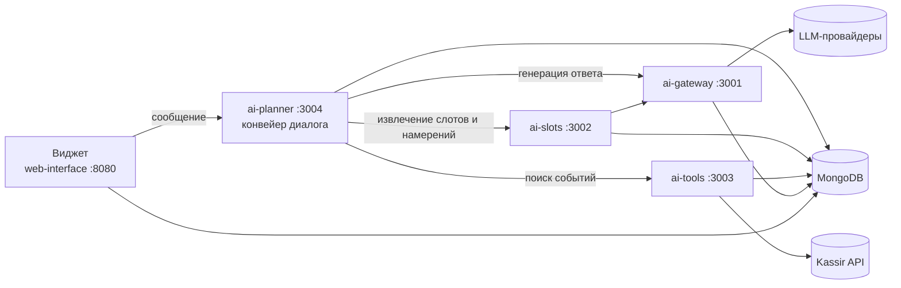

# AI Assistant

[](https://github.com/akoody/ai-assistant/actions/workflows/ci.yml)

ИИ-ассистент для подбора мероприятий на Kassir.ru: виджет-чат, который встраивается на сайт, понимает запрос на естественном языке («куда сходить с ребёнком в субботу недорого») и отвечает подборкой событий из афиши с карточками и кнопками.

## Возможности

- Диалог на русском: уточняет город, дату, категорию и жанр, запоминает предпочтения и бюджет.
- Поиск по каталогу Kassir с маршрутизацией по категориям, жанрам, настроению и популярным подборкам города.
- Отдельные сценарии для жалоб, критики, вопросов не по теме, smalltalk и жалоб на самочувствие.
- Несколько LLM-провайдеров с балансировкой и очередью запросов.
- Админ-панель с аналитикой открытий виджета, сообщений и кликов по событиям.

## Как устроено



Стек: Node.js 22, Express, MongoDB, Jest и `node:test`, ESLint, Prettier. Подключение виджета к сайту описано в [`web-interface/public/WIDGET_README.md`](web-interface/public/WIDGET_README.md).

## Запуск

Требуется Node.js 22.19+ и доступная MongoDB. Сервисы устанавливаются независимо:

```sh
npm ci
npm --prefix microservices/ai-gateway ci
npm --prefix microservices/ai-slots ci
npm --prefix microservices/ai-tools ci
npm --prefix microservices/ai-planner ci
npm --prefix web-interface ci
```

Создайте корневой `.env` по `.env.example`. Заполните MongoDB, внутренний API-ключ, учётные данные администратора и JWT-секреты. Для генерации секрета: `openssl rand -hex 32`. Существующий `.env` перезаписывать не нужно.

Настройки промптов, слотов и моделей по-прежнему хранятся в MongoDB. Для новой базы используйте `npm run db:init` в нужном сервисе; у gateway скрипт вызывается как `node scripts/init-db.js`. Повторная инициализация с `FORCE_UPDATE=true` меняет существующую конфигурацию, поэтому не нужна для установки этого рефакторинга.

```sh
npm start
```

Порты задаются в `microservices-ports`: gateway 3001, slots 3002, tools 3003, planner 3004, web 8080. Команда запуска передаёт каждому процессу свой `PORT`; при остановке или отказе одного сервиса завершает остальные.

## Проверки

```sh
npm run check
npm test
npm run format
```

`check` проверяет синтаксис, наличие статических и динамических локальных импортов, циклические импорты, регулярные выражения с `\b` рядом с кириллицей (в JavaScript такая граница никогда не срабатывает), ESLint (`no-undef`, `no-unused-vars`) и форматирование Prettier. `format` приводит код к стилю Prettier.

`test` запускает модульные тесты всех сервисов и возвращает ошибку, если упал любой набор. В модульных тестах сеть отключена (`shared/testing/disableNetwork.js`), а MongoDB подменяется, поэтому результат не зависит от запущенных локально сервисов и от `.env`. Сквозной тест `ai-planner/src/routes/chat.test.js` проводит запрос `POST /api/chat/message` через HTTP, авторизацию, извлечение слотов, конвейер ответа и поиск Kassir.

Тесты с реальной БД и провайдерами запускаются отдельно: `npm run test:integration` в gateway или slots, на отдельной тестовой базе.

GitHub Actions (`.github/workflows/ci.yml`) выполняет `check` и `test` для каждого pull request и пуша в `main`, на чистой установке без `.env`.

## Архитектура

Каждый сервис устроен одинаково: `src/app.js` создаёт Express-приложение (без порта и подключения к БД, поэтому его можно тестировать), `src/index.js` только запускает сервис через `shared/serviceRuntime.js`. Общий каркас даёт разбор JSON, журнал запросов, JSON-ошибки, таймауты из окружения и корректную остановку по SIGINT/SIGTERM: сервер перестаёт принимать запросы, завершает открытые и закрывает подключения.

- `web-interface/src`: приложение, конфигурация, авторизация, маршруты и аналитика; `server.js` запускает и останавливает процесс.
- `microservices/ai-planner/src/services/response`: конвейер диалога.
- `microservices/ai-planner/src/services/response/replies`: обработчики сценариев, которые могут ответить сразу (жалобы, критика ассистента, off-topic, smalltalk, отзывы, покупка билетов и др.).
- `microservices/ai-planner/src/services/offers`: маршруты поиска, нормализация, фильтрация, ранжирование и подбор карточек.
- `microservices/ai-slots/src/services/extraction`: очередь извлечения, привязка слотов к тексту, ограничения сохранения и эвристики.
- `microservices/ai-tools/src/services/kassir`: HTTP-клиент Kassir, маршрутизация запросов, фильтрация, исключение повторов и методы каталога.
- `shared`: общие бизнес-правила, каркас сервисов, загрузка окружения и подключения к MongoDB.

Прежние файлы `llmResponseService.js`, `offerService.js`, `queueService.js` в slots и `kassirApiTool.js` сохраняют публичные экспорты как фасады.

### Конвейер диалога

`responseOrchestrator.js` последовательно вызывает `routeRequest`, `reconcileSlots`, `resolveSearchSlots`, `prepareSearchContext`, `generateOffers`, `composeReply`, `finalizeReply`. Этап либо отвечает (`{ kind: 'reply', response }`), либо передаёт результаты дальше (`{ kind: 'continue', context }`). Результат каждого этапа хранится под своим именем: `request`, `routing`, `slots`, `searchSlots`, `searchContext`, `offers`, `reply`. Сигнатура этапа показывает, из какого этапа берётся каждый вход, например:

```js
export async function prepareSearchContext({
  request: { userId, sessionId, userMessage, requestId },
  routing: { isChangeCityRequest, session, isShowMoreRequest, recommendationsIntent },
  slots: { history, showAllIntent },
  searchSlots: { effectiveSlots, slotsChanged, fallbackQuery, keywordOverride },
}) {
```

`routeRequest` определяет намерения и по очереди спрашивает обработчики из `replies/`. Обработчик возвращает `{ kind: 'reply' }`, если отвечает сам; `{ kind: 'continue', ...изменения }`, если запрос нужно продолжить с уточнённым состоянием (например, off-topic, который нашёлся в афише); или `null`, если сценарий не подходит.

### Необязательные файлы

`popul.txt` в корне проекта может переопределить встроенный список популярных подборок по городам (по одному URL `https://<город>.kassir.ru/selection/...` на строку). Без него используется встроенный список.

## Секреты и архивы

Корневой `.env` исключён из Git. Переменные конкретного сервиса имеют приоритет над `INTERNAL_API_KEY`, затем читается прежняя конфигурация из БД. Известный тестовый ключ разрешён только при `NODE_ENV=test`; рабочие процессы требуют собственный ключ.

`POLZA_API_KEY` и `KASSIR_API_TOKEN` читаются из окружения с сохранением совместимости с прежними настройками БД. Новые конфигурации gateway указывают `apiKeyEnv` вместо сохранения ключа провайдера в документе модели.

```sh
npm run archive -- --name widgetkassir.zip
```

Архив содержит текущие файлы проекта, включая незакоммиченные изменения. `.env.example` включается; реальные `.env*`, приватные ключи, зависимости, логи, IDE-каталоги и прежние архивы исключаются. Удалённые файлы не попадают в архив. Уже созданные старым скриптом архивы требуют отдельной проверки.
